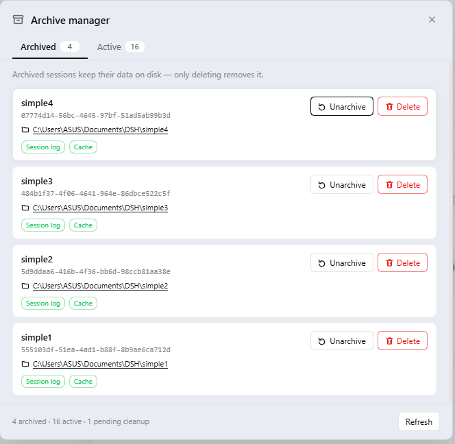
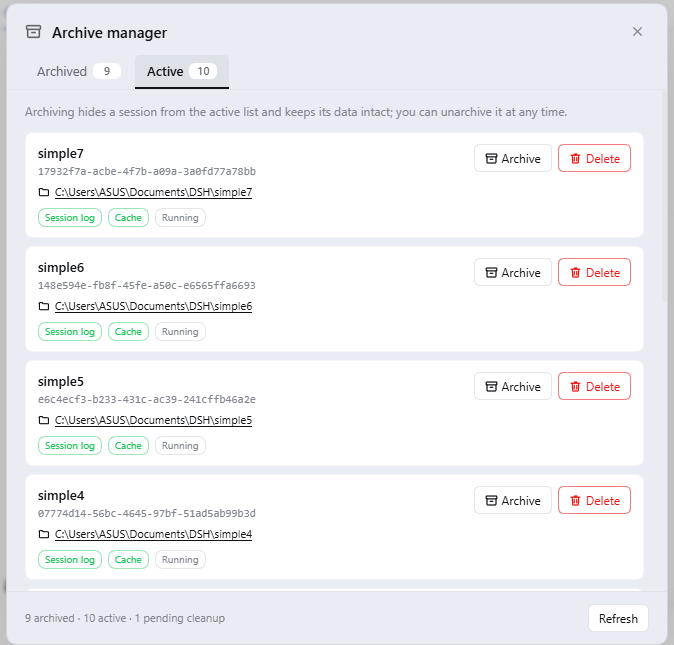

# dsh-archive-manager

**English** | [中文](README.zh.md)

[](./LICENSE)
[](https://github.com/Joe-0202/dsh-archive-manager/releases)
[](https://github.com/Joe-0202/dsh-archive-manager)

Archive manager plugin: manage **archived sessions** and **active sessions** of DeepSeek Harness (DSH) in one place.

> **Quick install** (restart DSH afterwards and you are done)
>
> ```bash
> dsh plugin --profile desktop add github:Joe-0202/dsh-archive-manager
> ```
>
> Other install methods: see [Installation](#installation) | Version downloads: see [Releases](https://github.com/Joe-0202/dsh-archive-manager/releases)

## Why this plugin exists

DSH has built-in session archiving: archiving a session keeps its data **fully on disk** and merely hides it from the active list. But the built-in archive handling offers only a single filter ("Hide archived / All conversations / Archived only") and **no dedicated place** to review, archive, or clean up sessions in one spot — archived sessions simply pile up on disk.

This plugin fills that gap: it **reuses DSH's native archiving mechanism** and adds a dedicated management UI where "archive" and "delete" sit side by side.

## Features

### Sidebar entry

A new "Archive Manager" icon at the bottom of the sidebar (next to Settings); click it to open the management panel.

### Two-tab panel

The panel has two tabs, and **every session row offers archive-type actions and delete side by side**:

| Tab | Contents | Actions per row |
|---|---|---|
| **Archived** | All archived sessions | [Unarchive] [Delete] |
| **Active sessions** | Currently active sessions | [Archive] [Delete] |

Each entry shows:
- Session title ("Untitled session" when there is no title)
- Session ID (monospace)
- Bound workspace directory (**clickable** — opens directly in the file manager)
- Status badges: `session log` / `cache` / `data missing` / `running`

### Three operations

- **Archive**: calls DSH's native `archiveSession`; the session is hidden from the active list and its **data is kept exactly as is**
- **Unarchive**: calls DSH's native `unarchiveSession`; the session returns to the active list and its **data was never moved**
- **Permanent delete**: removes the session's **session log directory + projection cache** (irreversible)
  - The **bound workspace directory is never deleted** (by design, so your project files cannot be removed by accident)
  - A confirmation dialog guards the operation
  - The archive record is queued and cleaned up automatically by the plugin on the **next DSH start** — no manual step required,
    and after a delete no "empty-data session" will reappear in the active list

### Ghost entry detection

Entries in the archived list whose data was deleted long ago and only an archive record remains are marked "data missing"; deleting such an entry clears that leftover record.

### Agent tools

`archive_list` / `archive_add` / `archive_remove` / `archive_delete`, drivable with natural language.

## Screenshots

The **Archived** tab — every entry offers [Unarchive] and [Delete], and shows the bound workspace directory and on-disk data status:



The **Active sessions** tab — [Archive] and [Delete] side by side:



## Installation

> Replace `<profile>` in the commands below with your profile name; the DSH desktop app uses `desktop` by default.
> After installing, **restart DSH** and the "Archive Manager" icon appears at the bottom of the sidebar.

### Option 1: Install directly from GitHub (recommended)

```bash
dsh plugin --profile <profile> add github:Joe-0202/dsh-archive-manager
```

DSH pulls the plugin from this repository and installs it into the profile as a bundle. To pin a specific version, add a ref:

```bash
dsh plugin --profile <profile> add github:Joe-0202/dsh-archive-manager#v0.1.0
```

### Option 2: Download a release and install locally

1. Open the [Releases](https://github.com/Joe-0202/dsh-archive-manager/releases) page,
   download **Source code (zip)** of the latest version and extract it
2. Install using the path of the extracted directory:

```bash
dsh plugin --profile <profile> add link:<absolute path of the extracted directory>
```

### Uninstall

```bash
dsh plugin --profile <profile> remove dsh-archive-manager
```

Uninstalling removes only the plugin itself; it does **not** delete any session data or archive records.

## Usage

1. Click "Archive Manager" at the bottom of the sidebar to open the panel
2. In the "Active sessions" tab, click [Archive] on sessions you no longer need — they are hidden from the active list while their data is kept as is
3. In the "Archived" tab, review all archived sessions
4. Click [Unarchive] when needed to put a session back into the active list
5. For sessions you no longer need, click [Delete] → confirm → permanent delete (irreversible)

## Safety notes

- **Deletion is irreversible**: the session log and projection cache are removed outright, and a confirmation dialog is shown first.
- **The bound workspace directory is never touched**: even if a session is bound to `D:\projects\xxx`, deleting an archived session removes **only session data**;
  your project directory and the files in it are completely unaffected.
- **Archiving itself carries zero risk**: it only writes a marker; no data is moved or copied, and you can unarchive at any time.
- Session data is located by **scanning `$DSH_HOME/sessions/*/` for an exact sessionId match** rather than re-deriving
  the path encoding, which avoids deleting the wrong directory.
- Deletion is idempotent: if the target directory or cache is already gone, it counts as "already deleted" instead of raising an error.

## Implementation notes

- **Source of the archived list**: the runtime projection is preferred (`workspaceController.follow()`'s first-frame baseline carries
  `archivedSessionIds`; the stream is aborted as soon as it is read), with a fallback to the persistent snapshot in
  `$DSH_HOME/storages/workspace.json`. The panel therefore reflects the in-memory truth rather than a possibly stale disk copy.
- **Active sessions**: `sessionQuery.listSessions()` (which already excludes archived sessions), plus a defensive de-duplication pass.
- **Session title / cwd**: read from the projection cache at `$DSH_HOME/storages/session_projcache/sessions/<id>.json`
  (the cache embeds these values in a `{ <key>: { val } }` structure).
- **Session log directory**: `$DSH_HOME/sessions/<workspace encoding>/<sessionId>/`, located by exact-match scanning;
  after deleting a session, if its workspace encoding directory becomes empty, that empty directory is cleaned up as well.
- **Archive / unarchive**: calls DSH's native `workspaceRegistry.archiveSession(id, { stopActivity: true })`
  and `unarchiveSession(id)` — the plugin does not implement archiving semantics itself.
- **Removal from the archive set goes through the "pending-cleanup queue" (key design)**: permanent delete has three steps — delete the log, delete the cache, and
  **enqueue** the id, but **does not unarchive at that moment**.
  The reason: `unarchiveSession` means "send this session back to the active list", not "forget this id".
  If you previously opened a session in the archive panel, it stays in the harness's memory; deleting the on-disk data
  and then unarchiving makes the harness put this session — no data, but still in memory — back into the active list,
  where opening it necessarily fails with `session/not-found` — and **only a restart clears it**.
  Once queued, the session stays archived (so it can never appear in the active list) and the plugin runs
  `unarchiveSession` on the **next start** to finish the job — at that moment memory is clean, so unarchiving cannot trigger a ghost.
  Queue file: `$DSH_HOME/storages/archive-manager-pending.json`;
  queued entries are hidden from the panel immediately and surfaced transparently in the footer as "N pending cleanup".
- **Delete / open folder** run through the `subprocess` service
  (Windows: `Remove-Item -Recurse -Force` / `cmd /c start explorer`; POSIX: `rm -rf` / `xdg-open`).
- **Client-side UI**: a hand-written `window.__ModuleLoader__.load` lazy-CJS bundle with zero build steps;
  the stylesheet is injected through the `styles` builtin (falling back to a manual `<style>` tag), and everything uses DSH's
  `--dsw-alias-*` design tokens so it matches the built-in UI's visual system; the panel is mounted on `document.body`
  so it is not unmounted when a slot re-renders.

## Directory structure

```
archive-manager/
├── package.json          # plugin manifest + dsh.client declaration
├── cordis.patch.yml      # bundle patch (mounts the plugin row)
├── screenshots.json      # storefront screenshot declaration
├── assets/               # UI screenshots
├── dsh/
│   ├── index.js          # Host side: archive set, archive/unarchive/permanent delete, pending queue, routes/tools
│   └── client.js         # Client side: sidebar entry + two-tab panel (lazy-CJS bundle, zh/en dictionaries)
├── CHANGELOG.md
├── LICENSE
├── README.md             # English (this file)
└── README.zh.md          # Chinese
```

## Known limitations

- Panel data is fetched when the panel opens and after every operation; click "Refresh" in the panel's bottom-right corner for the latest state.
- The "running" badge means that active session currently has a live agent resident in memory.
- A deleted session's **archive record** is cleaned up automatically by the plugin on the next DSH start; before that start it is already
  hidden from the panel, and the footer shows "N pending cleanup". This step requires no manual action.

## Disclaimer

- This project is a **third-party open-source plugin** maintained independently by a community developer. It is **not an official DeepSeek project**
  and has no affiliation, sponsorship, or endorsement relationship with DeepSeek.
- Names and trademarks such as "DeepSeek" and "DeepSeek Harness" belong to their respective owners;
  this project uses these names only to **describe compatibility** and uses no logos or brand marks of theirs.
- This plugin **permanently deletes** session data as you instruct. The author accepts no liability for data loss caused by
  accidental deletion (the software is provided "as is" under the MIT License, see below).

## License

MIT (see [LICENSE](./LICENSE))

## Open source and contributing

- Issues and Pull Requests are welcome.
- **Local development**: no build step is required (the source is the artifact). Edit `dsh/index.js` (Host side) or
  `dsh/client.js` (Client side) directly, link-install it with the command below, then restart DSH for the changes to take effect:

  ```bash
  dsh plugin --profile <profile> add link:<absolute path of this directory>
  ```

- **Code structure**:
  - `dsh/index.js` — Host side: reading the archive set, archive/unarchive, permanent delete, pending-cleanup queue,
    HTTP routes, agent tools.
  - `dsh/client.js` — Client side: sidebar entry, two-tab panel, custom confirmation dialog,
    stylesheet injection (all using the harness's `--dsw-alias-*` design tokens).
- **Publishing to npm** (optional; the main distribution channel today is direct install from GitHub):

  ```bash
  npm login
  npm publish
  ```

  After publishing, users can install it with `dsh plugin --profile <profile> add dsh-archive-manager`.
  If that package name is already taken on npm, switch to a scope (for example `@joe-0202/dsh-archive-manager`)
  and update the `insert[].name` value in `cordis.patch.yml` accordingly.
- **Contribution license**: by submitting a Pull Request you agree that your contribution is released under this project's MIT License.
