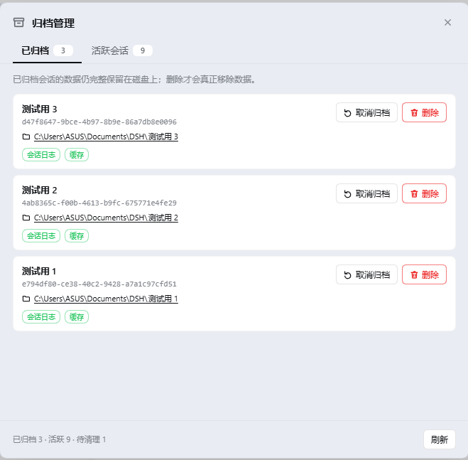
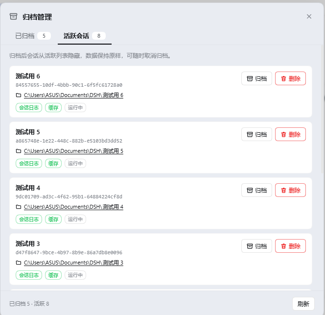

# dsh-archive-manager

[](./LICENSE)
[](https://github.com/Joe-0202/dsh-archive-manager/releases)
[](https://github.com/Joe-0202/dsh-archive-manager)

归档管理插件：集中管理 DeepSeek Harness（DSH）的**已归档会话**与**活跃会话**。

> **快速安装**（装完重启 DSH 即可）
>
> ```bash
> dsh plugin --profile desktop add github:Joe-0202/dsh-archive-manager
> ```
>
> 其他安装方式见 [安装](#安装)｜版本下载见 [Releases](https://github.com/Joe-0202/dsh-archive-manager/releases)

## 为什么需要它

DSH 自带会话归档：归档后会话数据**完整保留在磁盘**，只是从活跃列表里隐藏。但自带的归档管理只有一个筛选器（「隐藏已归档 / 全部对话 / 仅显示已归档」），**没有一个专门的地方**让你集中查看、归档、或清理会话——归档会话会一直堆在磁盘上。

本插件补齐这一环：**复用 DSH 原生归档机制**，提供一个专门的管理界面，让「归档」和「删除」并排可选。

## 功能

### 侧边栏入口

侧边栏底部（设置旁）新增「归档管理」图标，点击打开管理面板。

### 双 Tab 面板

面板有两个 Tab，**每个会话行上「归档类操作」与「删除」并排**：

| Tab | 内容 | 每行操作 |
|---|---|---|
| **已归档** | 全部已归档会话 | 【取消归档】【删除】 |
| **活跃会话** | 当前活跃会话 | 【归档】【删除】 |

每条显示：
- 会话标题（无标题显示「无标题会话」）
- 会话 ID（等宽字体）
- 绑定的工作目录（**可点击**，直接在资源管理器中打开）
- 状态徽章：`会话日志` / `缓存` / `数据已不存在` / `运行中`

### 三种操作

- **归档**：调用 DSH 原生 `archiveSession`，会话从活跃列表隐藏，**数据原样保留**
- **取消归档**：调用 DSH 原生 `unarchiveSession`，会话回到活跃列表，**数据从未移动**
- **彻底删除**：删除该会话的**会话日志目录 + 投影缓存**（不可恢复）
  - **绑定的工作目录不会被删除**（按设计，避免误删你的项目文件）
  - 有二次确认框
  - 归档记录会排入队列，由插件在 **DSH 下次启动时**自动清理——无需手动操作，
    且删除后**不会**有「空数据会话」跑回活跃列表

### 幽灵条目识别

归档列表里那些「数据早已被删、只剩一条归档记录」的条目会被标为「数据已不存在」，
删除它会清掉这条残留记录。

### Agent 工具

`archive_list` / `archive_add` / `archive_remove` / `archive_delete`，可用自然语言驱动。

## 界面预览

**已归档**页签——每条提供【取消归档】与【删除】，并显示绑定的工作目录与磁盘数据状态：



**活跃会话**页签——【归档】与【删除】并排：



## 安装

> 下面命令里的 `<profile>` 换成你的 profile 名；DSH 桌面端默认是 `desktop`。
> 安装完成后**重启 DSH**，侧边栏底部即出现「归档管理」图标。

### 方式一：从 GitHub 直接安装（推荐）

```bash
dsh plugin --profile <profile> add github:Joe-0202/dsh-archive-manager
```

DSH 会从本仓库拉取插件并作为 bundle 装入 profile。想锁定到某个版本可加 ref：

```bash
dsh plugin --profile <profile> add github:Joe-0202/dsh-archive-manager#v0.1.0
```

### 方式二：从 Release 下载后本地安装

1. 打开 [Releases](https://github.com/Joe-0202/dsh-archive-manager/releases) 页面，
   下载最新版的 **Source code (zip)** 并解压
2. 用解压出的目录路径安装：

```bash
dsh plugin --profile <profile> add link:<解压目录的绝对路径>
```

### 卸载

```bash
dsh plugin --profile <profile> remove dsh-archive-manager
```

卸载只会移除插件本身，**不会**删除任何会话数据或归档记录。

## 使用

1. 点击侧边栏底部的「归档管理」打开面板
2. 在「活跃会话」Tab 里对不需要的会话点【归档】——它从活跃列表隐藏，数据原样保留
3. 在「已归档」Tab 里查看所有归档会话
4. 需要时点【取消归档】把会话放回活跃列表
5. 不再需要的点【删除】→ 二次确认 → 彻底删除（不可恢复）

## 安全说明

- **删除是不可恢复的**：会话日志与投影缓存会被直接移除，删除前有二次确认框。
- **不会动绑定的工作目录**：即使会话绑定了 `D:\项目\xxx`，删除归档会话也**只删会话数据**，
  你的项目目录和其中的文件完全不受影响。
- **归档本身零风险**：归档只写一个标记，数据不移动、不复制，随时可取消归档。
- 会话数据定位通过**按 sessionId 精确匹配扫描** `$DSH_HOME/sessions/*/`，不自行重推导
  路径编码，避免删错目录。
- 删除是幂等的：目标目录或缓存已不存在时视为「已删除」，不会报错中断。

## 实现要点

- **归档列表来源**：优先读运行时投影（`workspaceController.follow()` 的首帧 baseline 携带
  `archivedSessionIds`，读到即中止流），失败时回退到 `$DSH_HOME/storages/workspace.json`
  的持久快照。这样面板反映的是内存真相，而不是可能滞后的磁盘副本。
- **活跃会话**：`sessionQuery.listSessions()`（它本身已排除归档会话），并做一次去重防御。
- **会话标题 / cwd**：从投影缓存 `$DSH_HOME/storages/session_projcache/sessions/<id>.json`
  里读取（缓存把这些值嵌在 `{ <key>: { val } }` 结构里）。
- **会话日志目录**：`$DSH_HOME/sessions/<工作区编码>/<sessionId>/`，通过精确匹配扫描定位；
  删完会话后若所在的工作区编码目录变空，一并清理该空目录。
- **归档 / 取消归档**：调用 DSH 原生 `workspaceRegistry.archiveSession(id, { stopActivity: true })`
  与 `unarchiveSession(id)`——插件不自己实现归档语义。
- **移出归档集走「待清理队列」（关键设计）**：彻底删除分三步——删日志、删缓存、把 id
  **排入队列**，但**不在此时取消归档**。
  原因：`unarchiveSession` 的语义是「把会话送回活跃列表」，而不是「忘掉这个 id」。
  只要你之前在归档面板里点开过某个会话，它就会留在 harness 的内存里；此时删掉磁盘数据
  再取消归档，harness 会把这个「没有数据、但内存里还在」的会话重新放进活跃列表，
  点开必然报 `session/not-found`——而且**必须重启才能消除**。
  排队后它始终保持归档（因此绝不会出现在活跃列表），由插件在**下次启动时**执行
  `unarchiveSession` 收尾——那一刻内存是干净的，取消归档不会再触发幽灵。
  队列文件：`$DSH_HOME/storages/archive-manager-pending.json`；
  排队中的条目会立即从面板隐藏，并在页脚以「待清理 N」透明显示。
- **删除 / 打开文件夹**通过 `subprocess` 服务执行
  （Windows：`Remove-Item -Recurse -Force` / `cmd /c start explorer`；POSIX：`rm -rf` / `xdg-open`）。
- **Client 端 UI**：手写 `window.__ModuleLoader__.load` lazy-CJS bundle，零构建步骤；
  样式表通过 `styles` builtin 注入（回退到手动 `<style>` 标签），全部使用 DSH 的
  `--dsw-alias-*` 设计 token，与自带界面同一套视觉体系；面板挂在 `document.body` 上，
  避免 slot 重渲染时被卸载。

## 目录结构

```
archive-manager/
├── package.json          # 插件清单 + dsh.client 声明
├── cordis.patch.yml      # bundle patch（挂载插件行）
├── LICENSE
├── README.md
└── dsh/
    ├── index.js          # Host 端：双列表 + 归档/取消归档/彻底删除 + 路由/工具
    └── client.js         # Client 端：侧边栏入口 + 双 Tab 管理面板（lazy-CJS bundle）
```

## 已知限制

- 面板数据在打开时与每次操作后拉取一次；如需最新状态点面板右下角「刷新」。
- 「运行中」徽章表示该活跃会话当前有 live agent 驻留内存。
- 删除后的**归档记录**会在 DSH 下次启动时由插件自动清理；启动前它已从面板隐藏，
  页脚会以「待清理 N」提示。这一步不需要你手动操作。

## 免责声明

- 本项目是**第三方开源插件**，由社区开发者独立维护，**并非 DeepSeek 官方项目**，
  与深度求索公司（DeepSeek）不存在隶属、赞助或背书关系。
- 「DeepSeek」「DeepSeek Harness」等名称与商标归其各自所有者所有；
  本项目仅在**说明兼容性**的意义上使用这些名称，未使用其标识或徽标。
- 本插件会按你的操作**永久删除**会话数据。因误删造成的数据丢失，作者不承担责任
  （软件按 MIT 许可「按原样」提供，见下）。

## 许可

MIT（见 [LICENSE](./LICENSE)）

## 开源与贡献

- 欢迎提 Issue 和 Pull Request。
- **本地开发**：无需构建步骤（源码即产物）。直接改 `dsh/index.js`（Host 端）或
  `dsh/client.js`（Client 端），用下面命令链接安装后重启 DSH 即可生效：

  ```bash
  dsh plugin --profile <profile> add link:<本目录绝对路径>
  ```

- **代码结构**：
  - `dsh/index.js` — Host 端：归档集读取、归档/取消归档、彻底删除、待清理队列、
    HTTP 路由、Agent 工具。
  - `dsh/client.js` — Client 端：侧边栏入口、双 Tab 面板、自定义确认框、
    样式表注入（全部使用 harness 的 `--dsw-alias-*` 设计 token）。
- **发布到 npm**（可选，当前主要分发方式是 GitHub 直装）：

  ```bash
  npm login
  npm publish
  ```

  发布后用户即可用 `dsh plugin --profile <profile> add dsh-archive-manager` 安装。
  若该包名在 npm 上已被占用，改用 scope 形式（如 `@joe-0202/dsh-archive-manager`），
  并同步更新 `cordis.patch.yml` 中 `insert[].name` 的取值。
- **贡献授权**：提交 Pull Request 即表示你同意你的贡献以本项目的 MIT 许可发布。
